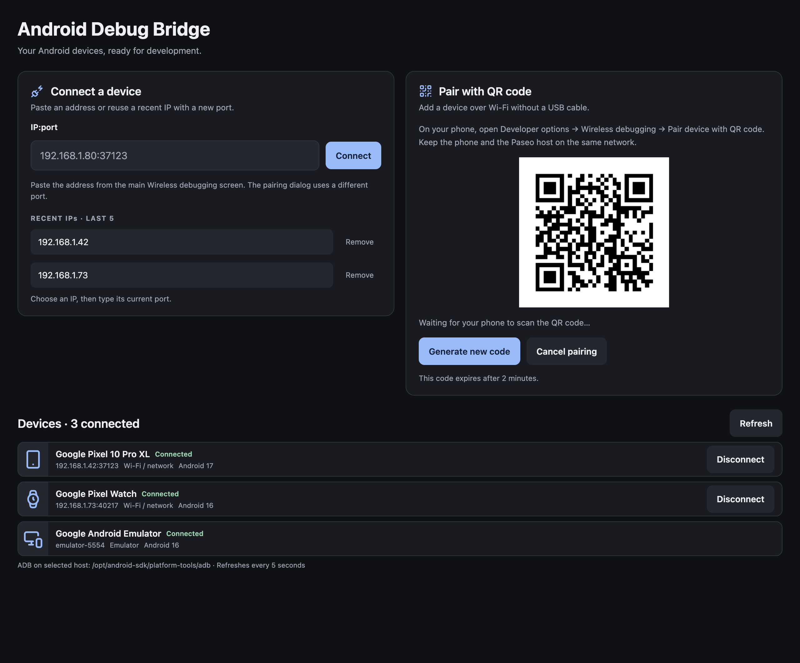

# Paseo ADB

**Your Android devices, right inside Paseo.**

Scan a QR code, paste an address, or reconnect to a familiar IP. Paseo ADB brings pairing, connections, and your device lineup into the place where you're already building.



_The plugin screen with example devices and a demo QR code._

## Connect once. Come back faster.

- **Scan to pair.** Generate a QR code and scan it from Android's Wireless debugging settings. Paseo ADB handles discovery, pairing, and connection.
- **Paste and go.** Copy the full `IP:port` from your device into one field, then hit Connect.
- **Keep your favorite devices close.** Your last five successful IPs stay handy. Pick one and type its current port.
- **Know what's connected.** See make, model, Android version, and connection status in compact rows that refresh automatically.
- **Recognize your hardware.** Phones, Wear OS watches, tablets, TVs, and emulators get matching icons when Android reports their device type.
- **Stay in your workflow.** Connect and disconnect network devices from the sidebar, with a host picker for your Paseo machines.

- **Type on your device.** Open **Send text** on a connected device, paste your text, and send it to the focused field through ADB.

## Get started

Install from the Paseo CLI:

```sh
paseo plugin install npm:paseo-adb@0.1.0
```

Or paste `npm:paseo-adb@0.1.0` into **Settings → Plugins**. Enable plugins, then open **ADB** in the sidebar. You can also install from source with `git:ajma/paseo-adb`.

You'll need **Paseo 0.12.0+** and **Android SDK Platform-Tools** on the Paseo host that will connect to your devices.

## Pair your first phone

1. Put your phone and Paseo host on the same Wi-Fi network.
2. In Paseo ADB, choose **Generate QR code**.
3. On your phone, open **Developer options → Wireless debugging → Pair device with QR code** and scan it.

Already paired? Paste the address from the main Wireless debugging screen and choose **Connect**.

Need help with setup, ADB discovery, or a stubborn connection? See the [setup and troubleshooting guide](docs/USAGE.md).
